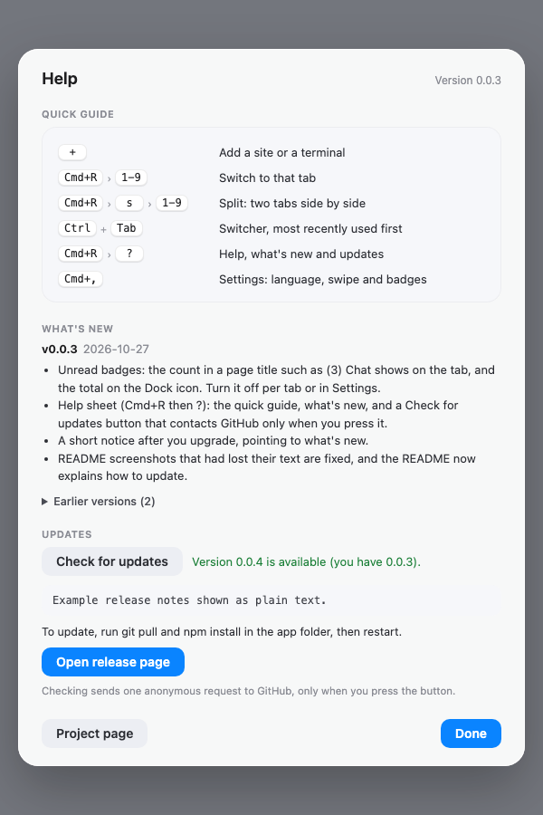

<div align="center">

# workhubme

**毎日使うサイトとターミナルを、ひとつのウィンドウに。操作はキーボードで。**

[](LICENSE)

-orange)


[English](README.md) · [Bahasa Indonesia](README.id.md) · **日本語**


<sub>分割表示: 代用のページとターミナルタブを並べたものです。アプリの実際のタブバーとターミナルの描画を組み合わせた図です。</sub>

</div>

---

## これは何か(正直に)

workhubme は **小さなブラウザシェル**です。Chromium([Electron](https://www.electronjs.org/) 経由)が、*あなた自身が*ピン留めしたサイトをタブごとに表示し、タブごとに別々のログイン状態を保ちます。任意の**ターミナルタブ**と、素早く移動するための **tmux 風のキーボードプレフィックス**もあります。

つまり [Ferdium](https://ferdium.org/)、[Rambox](https://rambox.app/)、Station など、「ウェブアプリをひとつのウィンドウにまとめる」ツールと同じ系統です。新しい技術ではなく、メッセンジャーでもなく、**特定サービスのクライアントでもありません**。ふつうのブラウザと同じように、指定したページを開くだけです。

作った理由はひとつです。マウスに触れずに、5〜6 個のタブとターミナルをすばやく切り替えること。たとえばサーバーで障害が起きたとき、チャットとシェルを並べて見たい場面を想定しています。

**向いている人**: ピン留めするサイトが数個で、キーボード中心の作業が好きで、午後ひとつで読み切れるくらい小さなものがほしい人。

**向いていない人**: 既成サービスのカタログ、端末間の同期、Windows や Linux への対応、大きなコミュニティを持つ成熟したプロジェクトを求める人。その場合は Ferdium や Rambox を使ってください。より成熟していて、できることも多いです。

## 見た目


| プレフィックスパネル | スイッチャー |
|:---:|:---:|
|  |  |

| タブの追加 | 設定 |
|:---:|:---:|
|  |  |



<sub>ヘルプ(`Cmd+R`、`?`)。ここに表示されている「利用可能」なアップデートは例のデータです。</sub>


<sub>すべての画像は、アプリ自身の UI ページを画面外でレンダリングしたもので、内容は架空のデモ、パネルの背後は代用のページです。冒頭の分割表示はそのうち 2 つを組み合わせています。UI の言語(English、Bahasa Indonesia、日本語)は設定で選べます。</sub>

## 機能

- **自分のタブ、自分のリスト。** 最初は空です。名前と `https://` のアドレスを入力して追加し、右クリックメニューで削除します。リストはこのリポジトリではなく、ユーザーのフォルダに保存されます。
- **ログインの分離。** タブごとに Cookie とサイトデータを保持します。「Google でログイン」プリセット(任意)を使うと、それを使うタブ同士で Google のセッションを共有します。
- **既定で厳格。** タブは自分のアドレス(と、あなたが追加したドメイン)だけを開けます。それ以外は既定のブラウザで開きます。
- **分割表示。** 2 つのタブを並べて表示します。
- **キーボードプレフィックス。** `Cmd+R` に続けて 1 キー。tmux と同じ発想で、対象はタブです。
- **スイッチャー。** `Ctrl` を押したまま `Tab`: 最近使った順にタブを切り替えます。
- **ターミナルタブ。** ログインシェルで `ssh` や `python` を手早く確認できます。タブを初めて開いたときに起動します。
- **3 つの言語。** English、Bahasa Indonesia、日本語。設定(`Cmd+,`)で切り替えます。既定ではシステムの言語に従います。
- **2 本指スワイプ(実験的、既定ではオフ)。** 右にスワイプで次のタブ、左で前のタブ。設定でオンにします。
- **未読バッジ。** `(3) Chat` のようにページのタイトルにある数字がタブに、合計が Dock アイコンに表示されます。WhatsApp と Gmail はそのまま動作します。ほかのサイトはタブ追加時にパターンを指定するか、タブごと、または設定でオフにできます。
- **WhatsApp のチャットをぼかす(任意)。** チャット一覧とメッセージをぼかし、画面をちらっと見られても何も分からないようにします。項目にカーソルを合わせると読めます。設定でオンにするか、`Cmd+R` の後に `v` を押します。
- **ヘルプと新機能。** `Cmd+R` の後に `?` で、クイックガイド、リリースノート、アップデート確認ボタンを開きます。
- **静か。** アカウントなし、テレメトリなし、アプリ自身の通信は、あなたが開始するアップデート確認を除いてありません。

## クイックスタート

```sh
git clone https://github.com/santoso-py/workhubme.git
cd workhubme
npm install
npm start
```

初回起動時に Electron のバイナリ(約 100 MB)をダウンロードするため、「Downloading Electron binary...」のまま少し待つことがあります。npm がインストールスクリプトをブロックする場合は、`node node_modules/electron/install.js` でその手順を明示的に実行できます。`node-pty` のバイナリはビルド済みで同梱されているため、コンパイルは不要です。

最初の起動では空のウィンドウが表示されます。**+** をクリックして、サイトまたはターミナルを追加すれば完了です。ファイルを直接編集したい場合は [`services.example.json`](services.example.json) が形式の例になります。


<sub>初回画面では、アプリの用途と最低限のキー操作を説明し、その場で言語も選べます。</sub>

動作環境: macOS(Apple Silicon で開発・検証)、Node.js、npm。

## 分割表示

2 つのタブを並べて表示します。たとえばサーバーで障害が起きたときに、チャットとターミナルを並べる使い方です。

1. 最初のタブを開きます。クリックするか、`Cmd+R` に続けて番号を押します。
2. 2 つ目を追加します。`Cmd+R`、`s`、続けて隣に表示したいタブの番号。タブを `Shift`+クリックしても同じです。
3. 2 つ目のタブは、名前の下に色付きのバーが付きます。ペイン内をクリックするとフォーカスされ、戻る・進む・再読み込み・ホームはフォーカス中のペインに対して働きます。
4. `Cmd+R`、`x` で分割を閉じます。`Shift` なしでタブを選ぶと、左のペインが入れ替わります。


## キーボード

プレフィックスは `Cmd+R` に続けて 1 キーです。`Esc` で取り消します。

| キー | 動作 |
|---|---|
| `Cmd+R`, `1`-`9` | そのタブに切り替え |
| `Cmd+R`, `s`, `1`-`9` | 分割: そのタブを現在のタブの隣に表示 |
| `Cmd+R`, `x` | 分割を閉じる |
| `Cmd+R`, `b` | タブバーの表示/非表示 |
| `Cmd+R`, `p` / `n` | フォーカス中のページで戻る / 進む |
| `Cmd+R`, `r` | 再読み込み |
| `Cmd+R`, `h` | タブの開始ページに戻る |
| `Cmd+R`, `c` | フォーカス中のタブのログアウト(確認あり) |
| `Cmd+R`, `,` または `Cmd+,` | 設定: 言語、スワイプ、バッジ |
| `Cmd+R`, `?` | ヘルプ: クイックガイド、新機能、アップデート確認 |
| `Cmd+R`, `v` | WhatsApp のぼかしをオン/オフ |
| `Ctrl` を押したまま `Tab` | スイッチャー。`Ctrl` を離すと移動 |
| `Shift`+タブをクリック | そのタブで分割 |

## ヒント

- **短い一語で起動する。** `~/.zshrc` にエイリアスを追加します。`me`、`work`、`hub` などが打ちやすい名前です。`type work` で名前が空いているか確認してください。
  ```sh
  alias work='(cd ~/workhubme && npm start >/dev/null 2>&1 &)'
  ```
  `source ~/.zshrc` を一度実行すれば、あとは `work` と打つだけです。バックグラウンドで起動するのでターミナルは空いたままです。出力を見たい場合は `>/dev/null 2>&1` を外してください。パスはリポジトリを clone した場所に合わせて変更します。
- **初回起動。** 最初の `npm start` で Electron(約 100 MB)をダウンロードします。省略された場合や、`node_modules` が消えた場合(たとえば `npm ci` の後)は、`node node_modules/electron/install.js` を実行してください。
- **言語。** 初回画面に言語の選択があります(English、Bahasa Indonesia、日本語)。選ぶまではシステムの言語に従います。あとから設定(`Cmd+,`)で変更できます。
- **ログイン画面がブラウザで開き、タブが読み込み中のまま。** タブが開けないドメインへ移動しようとしています。`~/Library/Logs/workhubme/blocked-navigation.log` を見て、そのドメインをタブ追加時の「追加ドメイン」に入れてください(Google の場合は「Google でログイン」にチェック)。すでに追加したタブは、`services.json` の `hosts` を編集して再起動します。
- **抜け出せないページに入ってしまったら。** `Cmd+R`、`p` で戻る、`Cmd+R`、`h` でタブの開始ページ、`Cmd+R`、`c` でそのタブをログアウトします。ページに「アカウントに権限がありません」と出るときに役立ちます。
- **ほかのサイトのバッジ。** サイトが独自の形でタイトルに件数を入れている場合は、タブ追加時の「未読バッジ」に、グループを 1 つ含む短いパターンを入力します(例: `tickets: (\d+)`)。空欄で自動、`off` で無効です。追加済みのタブは `services.json` に `"badge": "tickets: (\\d+)"` を設定して再起動します。
- **ぼかしが WhatsApp の一部を覆わなくなったら。** WhatsApp はときどきページを変更します。アプリを更新する([アップデート](#アップデート)を参照)か、応急処置としてそのタブに `services.json` で独自のセレクターを指定してください: `"blurSelectors": ["#pane-side [role=\"listitem\"]"]`(通常の CSS セレクターのみ、最大 10 個)。その後、再起動します。
- **設定のバックアップ。** `~/Library/Application Support/workhubme/` の `services.json` と `settings.json` をコピーしてください。
- **Electron を新しく保つ。** Electron は厳密なバージョンで固定されているため、`npm update electron` では何も変わりません。[アップデート](#アップデート)を参照してください。

## アップデート

workhubme は自動では更新されません。最新版にするには、clone したフォルダで次を実行します:

```sh
git pull
npm install
```

その後、アプリを再起動してください。タブと設定はリポジトリの外に保存されているため、そのまま残ります。アップデート後の最初の起動では短いお知らせが表示され、`Cmd+R` の後に `?` でヘルプを開くと**新機能**を確認できます。

- **アプリから確認する。** ヘルプ(`Cmd+R`、`?`、または 設定 → ヘルプと新機能)に**アップデートを確認**ボタンがあります。ボタンを押したときだけ GitHub に匿名のリクエストを 1 回送り、新しいリリースがあるかを知らせます。何かをダウンロードしたりインストールしたりすることはありません。
- **アプリを開かずに知る。** GitHub で **Watch → Custom → Releases** を選ぶか、`https://github.com/santoso-py/workhubme/releases.atom` を購読してください。
- **Electron は固定されています。** 厳密なバージョンで固定しているため、`npm update electron` では何も変わりません。セキュリティ修正は workhubme の新しいリリースとともに届きます。早く更新したい場合は `npm install --save-exact electron@latest` を実行して動作を確かめてください。

## データの保存場所

- タブのリスト: `~/Library/Application Support/workhubme/services.json`(このリポジトリの外にあり、コミットされません)
- 設定: 同じフォルダの `settings.json`
- ログイン情報とサイトデータ: 同じフォルダ内、タブごとに 1 パーティション
- ログ: `~/Library/Logs/workhubme/`。`blocked-navigation.log` と `actions.log` には origin と path だけを記録し、クエリ文字列は記録しません。

あなたがピン留めしたサイト自身がやり取りする通信と、ボタンを押したときのアップデート確認(GitHub への匿名リクエスト 1 回: アプリ名とバージョン、そして通常の Web リクエストと同じく IP アドレス)を除き、データがこのマシンの外に出ることはありません。

## セキュリティモデル

実際のアカウントを預ける前に、ぜひ読んでください。

- サイトのタブは `sandbox` と `contextIsolation` を有効にし、Node 統合なしで動きます。preload は小さなものがちょうど 1 つあり([`wheel-preload.js`](wheel-preload.js)、約 10 行)、分離されたワールドで動作して、スワイプ機能のためにスクロール量(2 つの数値)だけをアプリに渡します。ページからほかのものは読まず、ページには何も公開しません。任意のぼかし用スタイルシート(CSS のみ)を除き、アプリは開いたページを変更しません。ページのレンダラーが送れるメッセージはその 2 つの数値だけで、アプリはウェブサイトのタブからのものだけを受け付け、できることはタブの切り替えだけです。
- ページ自身のナビゲーションとリダイレクトは、そのタブで許可されたホスト(HTTPS のみ)に制限されます。それ以外は既定のブラウザで開き、記録されます。
- ページに許可するのは、通知、クリップボードへの書き込み、フルスクリーンだけです。
- ターミナルは、ログインシェルを**あなたの権限で**実行します。ページはローカルで、遷移もウィンドウを開くこともできず、ターミナルへのメッセージはすべてそのページのメインフレームから来たものに限り、サイズと型も検証されます。ほかのターミナルと同じように扱ってください。
- `services.json` は読み込み時に再検証されるため、手で編集したファイルでタブが開けるものを広げることはできません。
- 依存関係は厳密なバージョンで固定しています(Electron、`node-pty`、`xterm`)。**自動アップデートはありません**。新しいリリースを取得してください([アップデート](#アップデート)を参照)。Electron は Chromium を含み、固定されているため、そのセキュリティ修正は workhubme の新しいリリースとともに届きます。

問題を見つけたら [SECURITY.md](SECURITY.md) を参照してください。

## 正直な注意事項

ぜひ読んでください。多くの README が省く部分です。

- **独立した非公式のプロジェクトです。** ピン留めするどのサイトとも提携・承認・後援の関係はありません。WhatsApp や Gmail などの製品名は各所有者のものであり、何をピン留めできるかを説明するためだけに記載しています。ロゴは同梱していません。
- **ブラウザのウィンドウにすぎません。** ページの自動操作やスクレイピングはせず、あなたの代わりにメッセージを送ることもありません。読み取るのは、スクロール量(任意のスワイプ用)とページのタイトル(未読バッジ用)で、オンにした場合のみ WhatsApp のチャットをぼかすスタイルシートを追加します(見た目だけ、スクリプトなし)。いずれも保存や送信はされません。
- **ユーザーエージェント。** より多くのサイトでログインできるよう、アプリはユーザーエージェントから `Electron` の文字列を取り除きます。これはブラウザの名乗り方を変えるものです。サービスによっては拒否や制限をする可能性があります。また Google は 2021 年から、埋め込み WebView からの OAuth サインインをブロックしています([告知](https://developers.googleblog.com/en/upcoming-security-changes-to-googles-oauth-20-authorization-endpoint-in-embedded-webviews/)。Electron には言及がないため、ここに当てはまるかは不明です)。そのため、このアプリ内での Google ログインは失敗することがあります。
- **各サービスの利用規約を読んでください。** 一例として、WhatsApp の利用規約(2026 年 10 月に確認)は、自動化されたアクセス、大量メッセージ、非個人的な利用を制限しています。このアプリはそれらを行いませんが、ピン留めしたサービスをどう使うかはあなたの責任です。これは法的助言ではありません。
- **無料で、今後も変わりません。** MIT ライセンス。有料版、広告、トラッキング、寄付の勧誘はありません。
- **AI の支援を受けて作られています。** AI コーディングアシスタント(Claude Code)で構築し、メンテナが方向付けとテストを行いました。第三者によるセキュリティ監査は受けていません。大切なものを預ける前にコードを読んでください。意図的に小さくしてあります。
- **無保証。** [LICENSE](LICENSE) を参照してください。

## 既知の制限

- 汎用ブラウザではありません。アドレスバー、履歴、ブックマーク、拡張機能はありません。
- 現時点では macOS のみです。Windows と Linux は未検証で、ウィンドウ関連のコードの一部は macOS 固有です。
- ダウンロードは Electron 標準の保存ダイアログを使います。通知をクリックしてもタブにフォーカスしません。未読バッジはありません。
- UI は English、Bahasa Indonesia、日本語で利用できます。インドネシア語と日本語の文言はネイティブによる確認を受けていません。修正を歓迎します。
- 2 本指スワイプは実験的で、macOS 標準のスワイプほど滑らかではありません。指に追従するのではなく、スワイプが一定量を超えた時点でタブが切り替わり、ページを横にスクロールしたときも反応することがあります。既定ではオフで、ターミナルタブでは動作しません。
- ぼかしは画面を覆うだけのもので、セキュリティ機能ではありません。メッセージはページ内に残っています。WhatsApp がページを変更すると効かなくなりうるセレクターに依存しています。
- バッジは、件数をページのタイトルに表示するサイトでのみ動作します(WhatsApp と Gmail は対応、多くのサイトは非対応)。ページは自分のタイトルに任意の数字を入れられるため、バッジは目安として扱ってください。通知をクリックしてもそのタブは開きません。
- プレフィックス(`Cmd+R`)やほかのショートカットはまだ変更できません。設定にあるのは言語、スワイプ、バッジです。
- 署名なし、ソースから実行します。自分で `.app` をビルドして配布する場合は、Electron 配布物に含まれる Electron の `LICENSE` と Chromium の `LICENSES.chromium.html` を同梱してください。
- 初期段階のソフトウェア(0.0.2)です。粗い部分があります。

## クレジットとライセンス

MIT、[LICENSE](LICENSE) を参照。サードパーティのライセンスは [THIRD_PARTY_LICENSES.md](THIRD_PARTY_LICENSES.md) にまとめています。[Electron](https://www.electronjs.org/)、[xterm.js](https://xtermjs.org/)、[node-pty](https://github.com/microsoft/node-pty) を使って作られています。タブの形は一般的なブラウザのタブやセグメントコントロールのデザインに着想を得ており、コードはこのプロジェクトのために書かれたものです。
