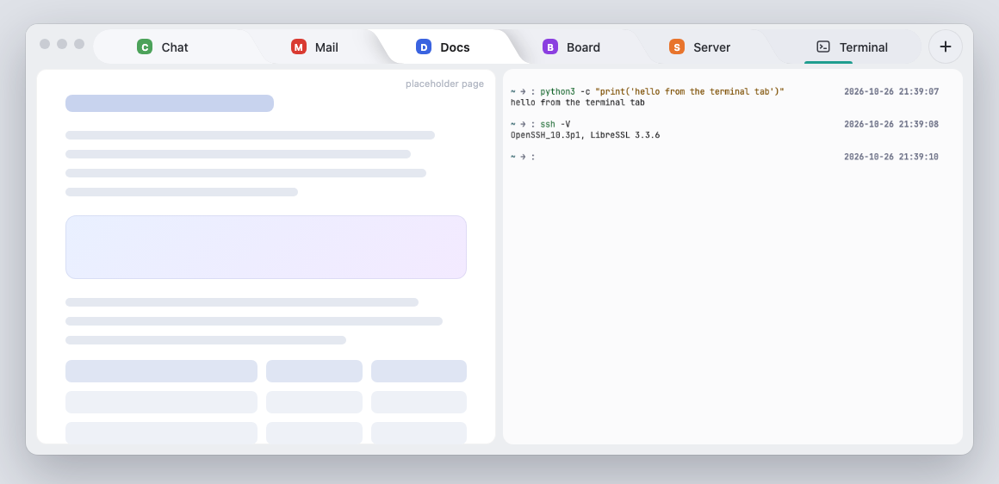
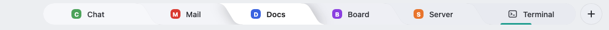
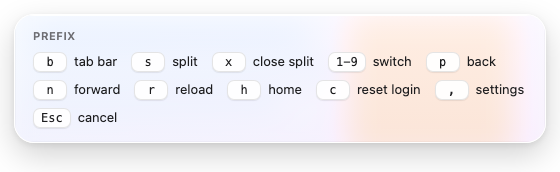
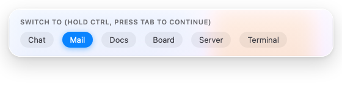
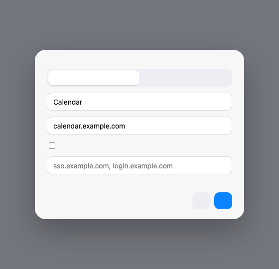
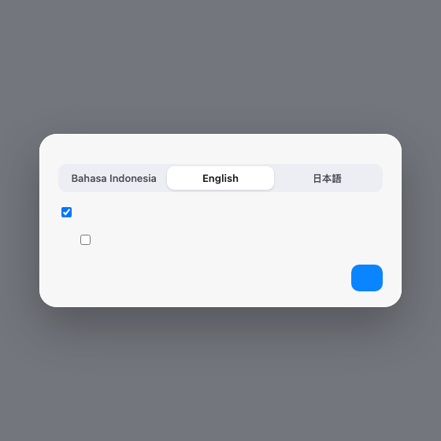
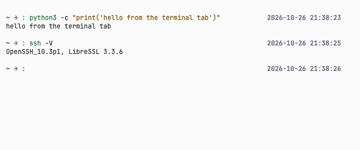
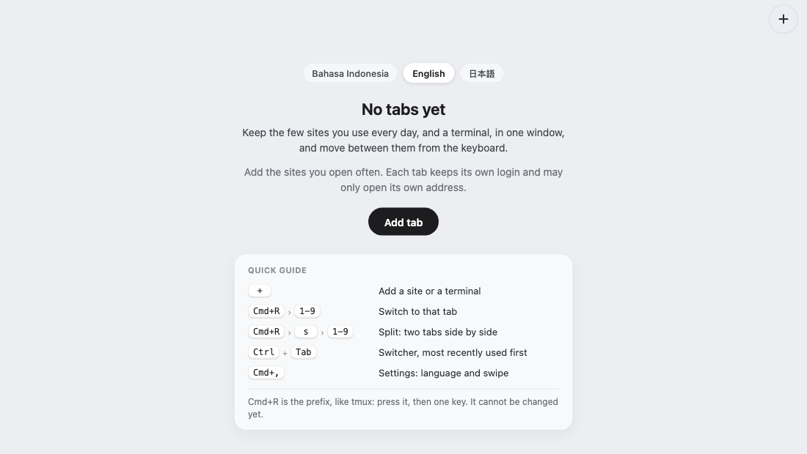

<div align="center">

# workhubme

**The few sites you use every day, plus a terminal, in one window. Driven from the keyboard.**

[](LICENSE)

-orange)


**English** · [Bahasa Indonesia](README.id.md) · [日本語](README.ja.md)



<sub>Split view: a placeholder page beside the terminal tab. An illustration composed from the app's real tab bar and terminal renders.</sub>

</div>

---

## What this is, honestly

workhubme is a **small browser shell**. It is Chromium (through [Electron](https://www.electronjs.org/)) showing a fixed set of sites that *you* pin, one tab each, every tab with its own login. It also has an optional **terminal tab** and a **tmux-style keyboard prefix** for moving around fast.

That puts it in the same family as [Ferdium](https://ferdium.org/), [Rambox](https://rambox.app/), Station and similar "put your web apps in one window" tools. It is not new technology, it is not a messenger, and it is **not a client for any service**: it only opens the pages you tell it to open, the same way a browser would.

It exists for one reason: switching between five or six tabs and a terminal quickly, without touching the mouse, for example when something breaks on a server and you need chat and a shell side by side.

**It is for you if** you pin a handful of sites, like keyboard workflows, and want something small enough to read in an afternoon.

**It is not for you if** you want a catalogue of ready-made services, sync across devices, Windows or Linux support, or a mature project with a big community. Use Ferdium or Rambox for that. They are more established and do more.

## What it looks like



| Prefix panel | Switcher |
|:---:|:---:|
|  |  |

| Add a tab | Settings |
|:---:|:---:|
|  |  |



<sub>All images are the app's own UI pages rendered offscreen with fictional demo content and a placeholder page behind the panels; the split view at the top is composed from two of them. The interface language (English, Bahasa Indonesia, 日本語) is chosen in Settings.</sub>

## Features

- **Your tabs, your list.** Starts empty. Add a name and an `https://` address; remove tabs from the right-click menu. The list lives in your user folder, not in this repo.
- **Separate logins.** Each tab keeps its own cookies and site data. An optional "Login with Google" preset lets tabs that use it share one Google session.
- **Strict by default.** A tab may only open its own address (plus extra domains you list). Anything else opens in your default browser.
- **Split view.** Show two tabs side by side.
- **Keyboard prefix.** `Cmd+R`, then one key. Like tmux, but for tabs.
- **Switcher.** Hold `Ctrl`, press `Tab`: tabs ordered by most recently used.
- **Terminal tab.** Your login shell, for quick `ssh` or `python` checks. It starts the first time you open the tab.
- **Three languages.** English, Bahasa Indonesia and 日本語, switched in Settings (`Cmd+,`). Defaults to your system language.
- **Two-finger swipe (experimental, off by default).** Swipe right for the next tab, left for the previous. Turn it on in Settings.
- **Quiet.** No account, no telemetry, no network traffic of its own.

## Quick start

```sh
git clone https://github.com/santoso-py/workhubme.git
cd workhubme
npm install
npm start
```

The first run downloads the Electron binary (about 100 MB), so it can sit on "Downloading Electron binary..." for a while. If your npm blocks install scripts, `node node_modules/electron/install.js` does that step explicitly. The `node-pty` binary ships prebuilt, so nothing is compiled.

The first launch shows an empty window. Click **+**, add a site or a terminal, and you are set. [`services.example.json`](services.example.json) shows the file format if you prefer to edit it by hand.



<sub>The first-run screen explains what the app is for and the few keys you need, and lets you pick the language right away.</sub>

Requirements: macOS (developed and tested on Apple Silicon), Node.js and npm.

## Split view

Show two tabs side by side, for example a chat next to a terminal while something is broken on a server.

1. Open the first tab: click it, or `Cmd+R` then its number.
2. Add the second: `Cmd+R`, `s`, then the number of the tab you want beside it. `Shift`+click on a tab does the same.
3. The second tab gets a coloured bar under its name. Click inside a pane to focus it: back, forward, reload and home act on the focused pane.
4. `Cmd+R`, `x` closes the split. Picking a tab without `Shift` replaces the left pane.


## Keyboard

The prefix is `Cmd+R`, then one key. `Esc` cancels.

| Keys | Action |
|---|---|
| `Cmd+R`, `1`-`9` | Switch to that tab |
| `Cmd+R`, `s`, `1`-`9` | Split: show that tab beside the current one |
| `Cmd+R`, `x` | Close the split |
| `Cmd+R`, `b` | Hide or show the tab bar |
| `Cmd+R`, `p` / `n` | Back / forward in the focused page |
| `Cmd+R`, `r` | Reload |
| `Cmd+R`, `h` | Back to the tab's start page |
| `Cmd+R`, `c` | Sign out of the focused tab (asks first) |
| `Cmd+R`, `,` or `Cmd+,` | Settings: language and swipe |
| Hold `Ctrl`, press `Tab` | Switcher; release `Ctrl` to go |
| `Shift`+click a tab | Split with that tab |

## Tips

- **Open it with one short word.** Add an alias to `~/.zshrc`. Names like `me`, `work` or `hub` are easy to type; check that the name is free with `type work`.
  ```sh
  alias work='(cd ~/workhubme && npm start >/dev/null 2>&1 &)'
  ```
  Run `source ~/.zshrc` once, then just type `work`. It starts in the background, so the terminal stays free; drop `>/dev/null 2>&1` if you want to see its output. Change the path to where you cloned the repo.
- **First run.** The first `npm start` downloads Electron (about 100 MB). If that was skipped, or `node_modules` was wiped (for example by `npm ci`), run `node node_modules/electron/install.js`.
- **Language.** The first-run screen has a language picker (English, Bahasa Indonesia, 日本語). Until you choose, the app follows your system language. Change it later in Settings (`Cmd+,`).
- **A sign-in page opened in your browser and the tab keeps loading.** The tab tried to go to a domain it may not open. Look at `~/Library/Logs/workhubme/blocked-navigation.log`, then add that domain under "Extra domains" when adding the tab (or tick "Sign in with Google" for Google). For a tab you already added, edit its `hosts` in `services.json` and restart.
- **Stuck on a page you cannot leave?** `Cmd+R`, `p` goes back; `Cmd+R`, `h` goes to the tab's start page; `Cmd+R`, `c` signs the tab out, which helps when a page says your account has no access.
- **Back up your setup.** Copy `services.json` and `settings.json` from `~/Library/Application Support/workhubme/`.
- **Keep Electron current.** Run `npm update electron` now and then.

## Where your data lives

- Tab list: `~/Library/Application Support/workhubme/services.json` (outside this repo, never committed)
- Settings: `settings.json` in the same folder
- Logins and site data: the same folder, one partition per tab
- Logs: `~/Library/Logs/workhubme/`. `blocked-navigation.log` and `actions.log` record origin and path only, never query strings.

Nothing leaves your machine except what the sites you pin send and receive themselves.

## Security model

Worth reading before you trust it with real accounts.

- Site tabs run with `sandbox` and `contextIsolation` and without Node integration. They have exactly one tiny preload, [`wheel-preload.js`](wheel-preload.js) (about ten lines), that runs in an isolated world and forwards only the amount of scrolling (two numbers) to the app for the swipe feature. It reads nothing else from the page and exposes nothing to it. The app does not change the pages you open. The one message a page's renderer can send is those two numbers; the app accepts it only from website tabs and the only thing it can do is switch tabs.
- Navigation and redirects of the page itself are limited to the tab's allowed hosts (HTTPS only). Anything else opens in your default browser and is logged.
- Only notifications, clipboard write and fullscreen are granted to pages.
- The terminal runs your login shell **with your privileges**. Its page is local, cannot navigate or open windows, and every message to it must come from that page's main frame, with sizes and types validated. Treat it like any other terminal.
- `services.json` is validated again on load, so a hand-edited file cannot widen what a tab may open.
- Dependencies are pinned exactly (Electron, `node-pty`, `xterm`). **There is no auto-update**: run `npm update electron` yourself from time to time, because Electron ships Chromium.

Found a problem? See [SECURITY.md](SECURITY.md).

## Honest notes

Please read these. They are the part most READMEs skip.

- **Independent and unofficial.** It is not affiliated with, endorsed by or sponsored by any site you pin. Product names such as WhatsApp or Gmail belong to their owners and appear here only to describe what you could pin. No logos are shipped.
- **It is a browser window, nothing more.** It does not automate, scrape or modify pages, and it does not send messages for you. The only thing it reads from a page is the amount of scrolling, for the optional swipe feature.
- **User agent.** To let more sites accept the login, the app removes the `Electron` token from its user agent. That changes how your browser identifies itself. Some services may refuse or restrict it, and Google has blocked OAuth sign-in from embedded webviews since 2021 ([announcement](https://developers.googleblog.com/en/upcoming-security-changes-to-googles-oauth-20-authorization-endpoint-in-embedded-webviews/); it does not mention Electron, so whether it applies here is unclear). Google sign-in inside this app may therefore fail.
- **Read each service's terms.** As an example, WhatsApp's terms of service (read in October 2026) restrict automated access, bulk messaging and non-personal use. This app does none of that, but you are responsible for how you use the services you pin. This is not legal advice.
- **Free and staying that way.** MIT licence. No paid tier, no ads, no tracking, no donation prompts.
- **Written with AI assistance.** Built with an AI coding assistant (Claude Code), directed and tested by the maintainer. It has not had an independent security audit. Read the code before trusting it with anything important; it is small on purpose.
- **No warranty.** See [LICENSE](LICENSE).

## Known limits

- Not a general browser: no address bar, history, bookmarks or extensions.
- macOS only for now. Windows and Linux are untested and some window code is macOS-specific.
- Downloads use Electron's default save dialog. Notification clicks do not focus the tab. No unread badges.
- The interface comes in English, Bahasa Indonesia and Japanese. The Indonesian and Japanese texts were written without native-speaker review; corrections are welcome.
- Two-finger swipe is experimental and not as smooth as native swiping: it switches the tab once your swipe passes a threshold instead of following your fingers, and scrolling a page sideways can also trigger it. It is off by default and never active on the terminal tab.
- The prefix (`Cmd+R`) and the other shortcuts cannot be changed yet; Settings only has language and swipe.
- Unsigned, run from source. If you build and share your own `.app`, include Electron's `LICENSE` and Chromium's `LICENSES.chromium.html` from the Electron distribution.
- Early software (0.0.2). Expect rough edges.

## Credits and licence

MIT, see [LICENSE](LICENSE). Third-party licences are listed in [THIRD_PARTY_LICENSES.md](THIRD_PARTY_LICENSES.md). Built with [Electron](https://www.electronjs.org/), [xterm.js](https://xtermjs.org/) and [node-pty](https://github.com/microsoft/node-pty). The tab shape is inspired by common browser and segmented-control designs; the code was written for this project.
